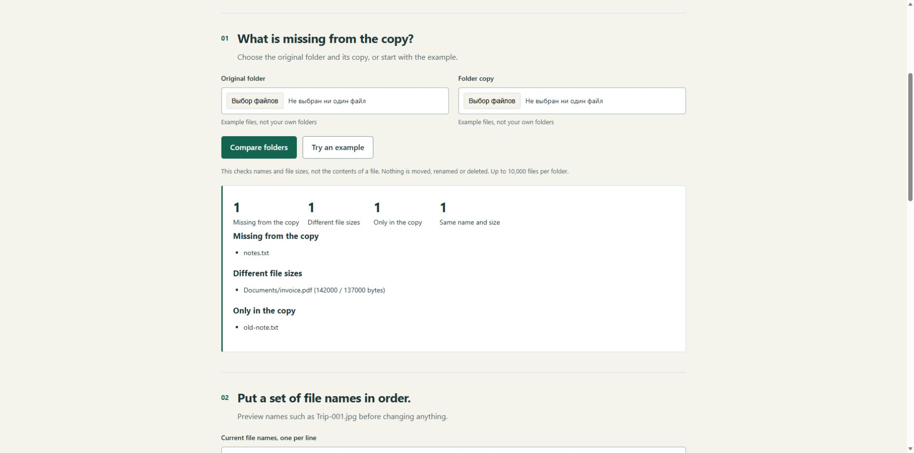

**English** · [Русский](README.ru.md)

# Small tools and practical computer help

I'm Dima Mak, also known as ub3dqy. I make small tools for everyday tasks and help work through confusing computer and software problems.

Maybe you keep doing the same job by hand. Maybe an app has stopped working and the instructions only make things more confusing. Tell me what you want to get done, and we'll work out a sensible way forward.

**[Download the PDF portfolio](portfolio-en.pdf)** · **[Try the example tools](practical-tools.zip?raw=true)**

## Small tools that save repetitive work

Comparing folders, preparing file names, checking lists, turning a string of small steps into one useful tool.

**What you get:** a tool built around the agreed task, a checked example and a short explanation of how to use it. The folder comparison and naming preview below show the sort of work I mean.

## Help with a stubborn computer problem

An app won't open, a setup guide skips a step, or an error keeps interrupting something you need to finish.

**What you get:** an explanation of what the evidence shows, practical next steps and a clear account of what still needs checking. If support needs to get involved, I can help put the details into a useful message.

## Everyday computer help, explained normally

Working with photos and documents, keeping track of copies, choosing the right folder, or following an installation guide without getting lost.

**What you get:** clear steps for the task in front of you. Where a change could affect your files, we agree what to change and what to keep first.

## Three examples you can try

These are small projects made for this portfolio. The supplied file names and situations are examples.

| The problem | What the example does |
| --- | --- |
| "Did everything make it into this folder copy?" | Lists missing files, extra files and different sizes. It compares names and sizes, not file contents. |
| "I want these photo names in a sensible order." | Prepares old and new names, keeps file endings and flags clashes in the supplied list. It does not rename files. |
| "I don't know how to explain what's gone wrong." | Turns a few notes into a clear help request. It does not diagnose the problem or send a message. |

[Download the tools](practical-tools.zip?raw=true), extract the folder and open **index.html**. English is the default; **Русский** switches the whole page. No installation or account is needed. Your files and text are not uploaded.

The folder picker is intended for a recent desktop browser. For a quick look without selecting any folders, choose **Try an example**.

## Improvements accepted by other projects

These are contributions to existing projects, made through my GitHub account **ub3dqy**.

- **Clearer Windows setup instructions.** Explained how to choose a local folder and distinguish it from a OneDrive folder in Screenshot Organizer. [Accepted change](https://github.com/Iqranawaz-debug/Screenshot_Organizer/pull/5).
- **Fewer steps to get the example files.** Replaced two file-page links with direct file links and explained how to save them in the ShareR walkthrough. [Accepted change](https://github.com/DepressionCenter/ShareR/pull/36).
- **A less confusing first exercise.** Clarified the starting point and made the expected report easier to read in Data Engineering Launchpad. [Accepted change](https://github.com/DineshDhanoki/data-engineering-launchpad/pull/19).

These changes improved the instructions. The applications themselves belong to their respective projects.

## Tell me what you're trying to do

Send a few lines about what you wanted to do and what happened instead. Include the error message, if there is one, or a screenshot with personal details hidden.

We'll agree on what's included, the price, the deadline and the payment method before work starts. I'm registered as an individual entrepreneur. If you need business paperwork, let me know when you describe the task.

Reply in the conversation where you received this portfolio. If you already use GitHub, you can also [leave a short request here](https://github.com/ub3dqy/practical-tech-help/issues/new). Keep personal files and sign-in details out of public posts.

**Dima Mak / ub3dqy**

[Русская версия](README.ru.md) · [English PDF](portfolio-en.pdf) · [Spreadsheet and writing examples](https://github.com/ub3dqy/spreadsheet-cleanup-examples)
