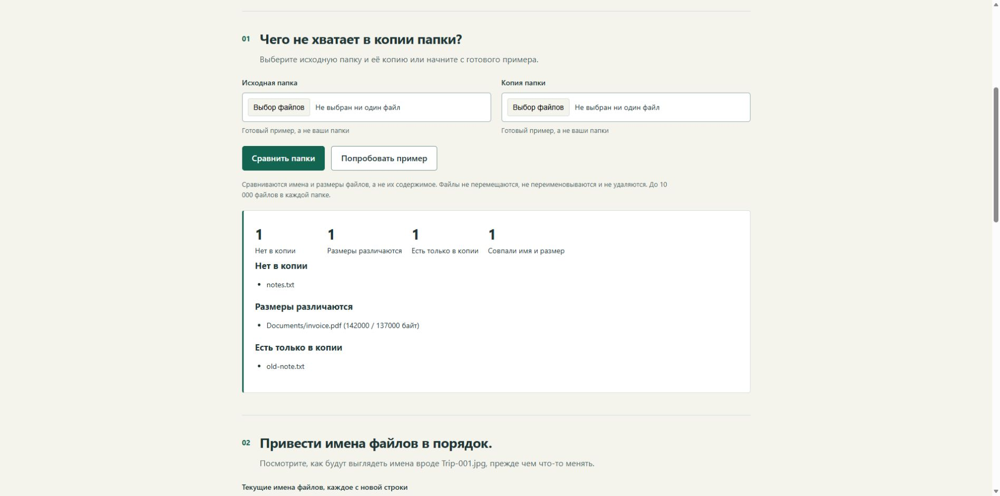

[English](README.md) · **Русский**

# Небольшие программы и понятная помощь с компьютером

Я Dima Mak, в сети — ub3dqy. Делаю небольшие полезные программы и помогаю разобраться с компьютерными проблемами, которые не получается решить с ходу.

Может быть, вы постоянно делаете одну и ту же работу вручную. Или программа перестала работать, а инструкция только запутывает. Расскажите, что нужно сделать, — разберёмся, с чего начать.

**[Скачать портфолио в PDF](portfolio-ru.pdf)** · **[Попробовать готовые примеры](practical-tools.zip?raw=true)**

## Небольшие программы для повторяющихся задач

Сравнить папки, подготовить новые имена файлов, проверить списки или собрать несколько ручных действий в один удобный инструмент.

**Что получите:** программу под согласованную задачу, проверенный пример и короткое объяснение, как ей пользоваться. Сравнение папок и подготовка имён ниже показывают, о какой работе идёт речь.

## Помощь с непонятной ошибкой

Программа не открывается, в инструкции пропущен важный шаг или ошибка мешает закончить дело.

**Что получите:** понятное объяснение того, что удалось выяснить, порядок дальнейших действий и список оставшихся вопросов. Если понадобится поддержка, помогу описать проблему так, чтобы не пришлось начинать разговор заново.

## Повседневные дела на компьютере

Фотографии и документы, проверка копий, выбор нужной папки или установка программы по запутанной инструкции.

**Что получите:** понятные шаги для вашей задачи. Если изменения могут затронуть файлы, сначала договоримся, что меняем и что сохраняем.

## Три примера, которые можно попробовать

Это небольшие проекты, сделанные для портфолио. Названия файлов и ситуации в готовых примерах учебные.

| Задача | Что делает пример |
| --- | --- |
| «Все ли файлы попали в копию папки?» | Показывает недостающие и лишние файлы, а также разные размеры. Сравнивает имена и размеры, а не содержимое файлов. |
| «Хочу привести имена фотографий в порядок» | Готовит список старых и новых имён, сохраняет окончания файлов и отмечает совпадения в переданном списке. Сами файлы не переименовывает. |
| «Не знаю, как объяснить, что случилось» | Собирает несколько заметок в понятное обращение за помощью. Не определяет причину ошибки и ничего не отправляет. |

[Скачайте примеры](practical-tools.zip?raw=true), распакуйте папку и откройте **index.html**. По умолчанию включён английский; кнопка **Русский** переводит всю страницу. Установка и аккаунт не нужны. Файлы и текст никуда не загружаются.

Выбор папок рассчитан на современный браузер на компьютере. Для быстрого знакомства можно ничего не выбирать: нажмите **Попробовать пример**.

## Улучшения, принятые в других проектах

Эти изменения отправлены через мой аккаунт GitHub **ub3dqy** и приняты авторами проектов.

- **Понятнее установка в Windows.** В инструкции Screenshot Organizer объяснено, как выбрать локальную папку и отличить её от папки OneDrive. [Принятое изменение](https://github.com/Iqranawaz-debug/Screenshot_Organizer/pull/5).
- **Проще скачать файлы примера.** В учебной инструкции ShareR две ссылки на страницы заменены прямыми ссылками на файлы и добавлена подсказка по сохранению. [Принятое изменение](https://github.com/DepressionCenter/ShareR/pull/36).
- **Яснее первые шаги учебной работы.** В Data Engineering Launchpad уточнено, с чего начать, а пример ожидаемого отчёта стал удобнее читать. [Принятое изменение](https://github.com/DineshDhanoki/data-engineering-launchpad/pull/19).

Эти изменения касались инструкций. Сами приложения принадлежат соответствующим проектам.

## Расскажите, что не получается

Напишите, что вы хотели сделать и что вышло вместо этого. Если есть ошибка, пришлите её текст или снимок экрана со скрытыми личными данными.

До начала работы договоримся, что нужно сделать, сколько это будет стоить, к какому сроку и как пройдёт оплата. Есть статус ИП; оформление можно обсудить вместе с задачей.

Ответьте в той переписке, где получили портфолио. Если пользуетесь GitHub, можно [оставить короткий запрос здесь](https://github.com/ub3dqy/practical-tech-help/issues/new). Личные файлы и данные для входа в открытом обращении не размещайте.

Небольшую доработку сайта можно [заказать на Kwork](https://kwork.ru/website-repair/55310656/dorabotayu-sayt-ispravlyu-oshibki-i-dobavlyu-nuzhnie-funktsii).

**Dima Mak / ub3dqy**

[English version](README.md) · [PDF на русском](portfolio-ru.pdf) · [Примеры работы с таблицами и текстами](https://github.com/ub3dqy/spreadsheet-cleanup-examples)
