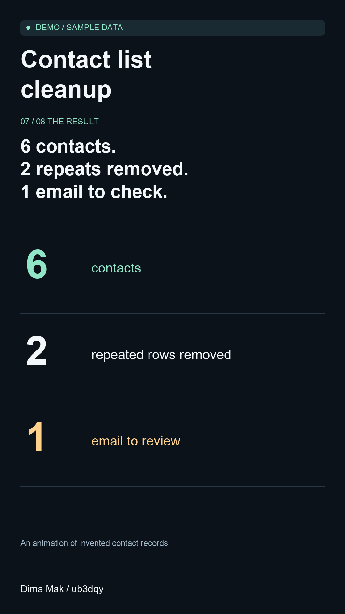

# Contact list cleanup in 50 seconds

[Русский](README.ru.md) · [Main portfolio](../README.md)

A short vertical video that explains a practical task: tidying a contact list without losing the original. Eight rows become six contacts, and one missing email stays visible for review.

## Watch the samples

| Language | First opening | Second opening |
| --- | --- | --- |
| English | [Watch or download](demo-en-hook-a.mp4?raw=true) | [Watch or download](demo-en-hook-b.mp4?raw=true) |
| Russian | [Смотреть или скачать](demo-ru-hook-a.mp4?raw=true) | [Смотреть или скачать](demo-ru-hook-b.mp4?raw=true) |

Each video runs for 50 seconds at 1080 × 1920. The two openings differ for the first three seconds; the rest of the explanation stays the same. All the text is on screen, with no voiceover or music.

## About this example

This animation was made for this portfolio, using invented names and addresses. It shows a simple explanation, readable captions and matching English and Russian versions.

Need a short video explaining a tool or a process? [Send a brief](https://github.com/ub3dqy/practical-tech-help/issues/new) with the intended audience, length and an example of the style you want. Keep private files and login details out of public requests.

**Dima Mak / ub3dqy**
