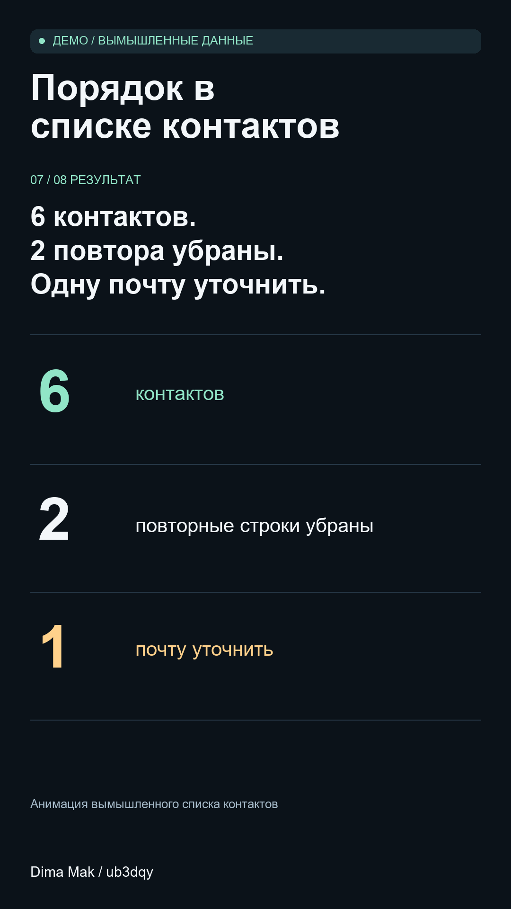

# Порядок в контактах за 50 секунд

[English](README.md) · [Основное портфолио](../README.ru.md)

Короткий вертикальный ролик о понятной задаче: привести список контактов в порядок и сохранить исходник. Из восьми строк остаётся шесть контактов, а запись без почты выделена для проверки.

## Посмотреть примеры

| Язык | Первое начало | Второе начало |
| --- | --- | --- |
| Русский | [Смотреть или скачать](demo-ru-hook-a.mp4?raw=true) | [Смотреть или скачать](demo-ru-hook-b.mp4?raw=true) |
| Английский | [Watch or download](demo-en-hook-a.mp4?raw=true) | [Watch or download](demo-en-hook-b.mp4?raw=true) |

Каждый ролик длится 50 секунд, размер — 1080 × 1920. Два варианта отличаются первыми тремя секундами, дальше объяснение одинаковое. Весь текст виден на экране, озвучки и музыки нет.

## Что показано

Эта анимация сделана для портфолио на вымышленных именах и адресах. В ней показаны простое объяснение, читаемые надписи и одинаковое содержание на русском и английском.

Нужен короткий ролик, который объяснит работу программы или порядок действий? [Опишите задачу](https://github.com/ub3dqy/practical-tech-help/issues/new): для кого ролик, какой длины и какой стиль вам нравится. Личные файлы и данные для входа не размещайте в открытом обращении.

**Dima Mak / ub3dqy**
